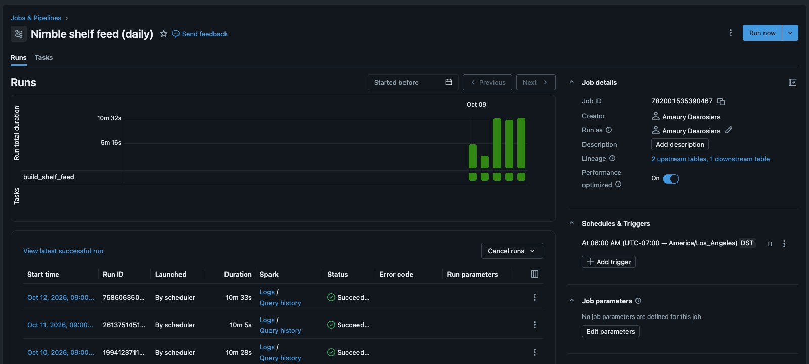

# 1. Retail pricing feed

This folder builds a daily feed of every product a shopper sees on Amazon, Walmart, Target, Foot Locker and ASOS. A serverless job adds a dated snapshot to the Delta table `shelf_products` every morning. You can compare the feed with a sample of the feed you buy today.



| Notebook | What it does | Time |
|---|---|---|
| `01_build_shelf_feed` | Runs 8 searches on 5 retailers and appends a dated snapshot to `shelf_products` | 3 min |
| `02_schedule_and_alert` | Creates the daily job, the view `shelf_alerts` and a SQL alert that emails you when the view has rows | 1 min |
| `03_dashboard` | Publishes the AI/BI dashboard **Running shoe shelf** | 1 min |
| `04_compare_with_your_feed` | Compares coverage, price match and freshness with a sample of your current vendor's feed | 1 min |

Each row in `shelf_products` holds the retailer, the search, the rank on the page, the brand, the price, the list price when the item is on sale, the rating, the review count and the sponsored flag.

## Change the feed

A new search is one row in the control table `shelf_queries`:

```sql
INSERT INTO shelf_queries VALUES ('amazon', 'nike vomero 18', true);
```

A new retailer is one line in `common/shelf.py` that names its Nimble Extract Template:

```python
RETAILERS = {
    # retailer: (Extract Template, name of its search parameter)
    "amazon": ("amazon_serp", "keyword"),
    "footlocker": ("footlocker_serp", "keywords"),
    ...
}
```

The write merges the schema, so a new field shows up as a new column.
