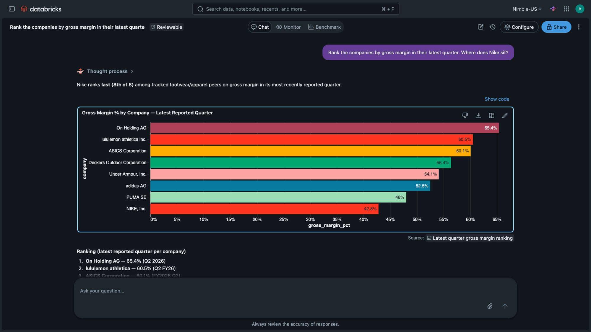

# 2. Agentic research

A Nimble Web Search Agent takes a task in plain language and researches the live web. It returns rows in a fixed schema, and every value carries its source URL and a confidence grade. The notebooks write the rows to Delta tables with a MERGE, so a rerun updates the same rows.

| Notebook | What it does | Time |
|---|---|---|
| `01_competitor_earnings` | Builds a table of quarterly revenue, growth, gross margin and operating income for 8 companies, from each company's own earnings releases and filings | 5 to 15 min |
| `02_ratings_and_reviews` | Adds rating, review count, price, praise and complaints to each product in the table `product_watchlist` | 10 to 25 min |
| `03_genie_space` | Creates the Genie space **Market research (Nimble)** over the tables and the live Nimble functions, then asks it three questions | 2 min |

## The agent specs

Each agent is a JSON file in `agents/`. The file holds the instructions, the goals, the sources to trust or block and the output schema. A new research question is a new spec file.

The first run creates each agent on your Nimble key. Later runs reuse it.
