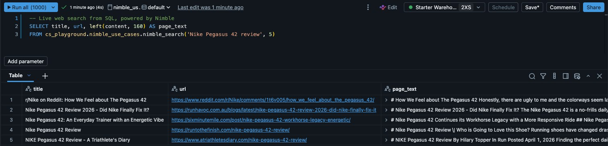

# 3. Platform integration

This folder gives every notebook, query and AI agent in the workspace the live web through one governed connection. Unity Catalog stores the connection, grants decide who can use it, and the audit log records every call.



| Notebook or file | What it does |
|---|---|
| `01_mcp_connection` | Creates the Unity Catalog connection `nimble_mcp` to the Nimble MCP server and lists its 27 tools. MCP (Model Context Protocol) is the open protocol AI agents use to call outside tools. You can also add Nimble from the Databricks Marketplace. |
| `02_market_analyst_agent` | Builds an Agent Bricks supervisor with the Genie space, the Nimble functions and the MCP connection, then asks it a question that needs both the tables and the live web |
| `03_governance` | Queries `system.access.audit` for every Nimble MCP call and every read of the Nimble key, by user and day, and shows who has access |
| `cursor_mcp.json` | Adds the same Nimble server to Cursor or GitHub Copilot, either through the Databricks proxy or directly |

## The connection

```sql
CREATE CONNECTION nimble_mcp TYPE HTTP
OPTIONS (
  host 'https://mcp.nimbleway.com',
  base_path '/mcp',
  bearer_token secret('nimble', 'api_key'),
  is_mcp_connection 'true'
);

GRANT USE CONNECTION ON CONNECTION nimble_mcp TO `ai-team`;
```
