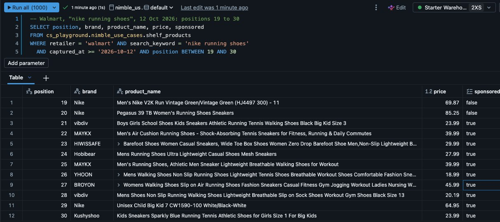
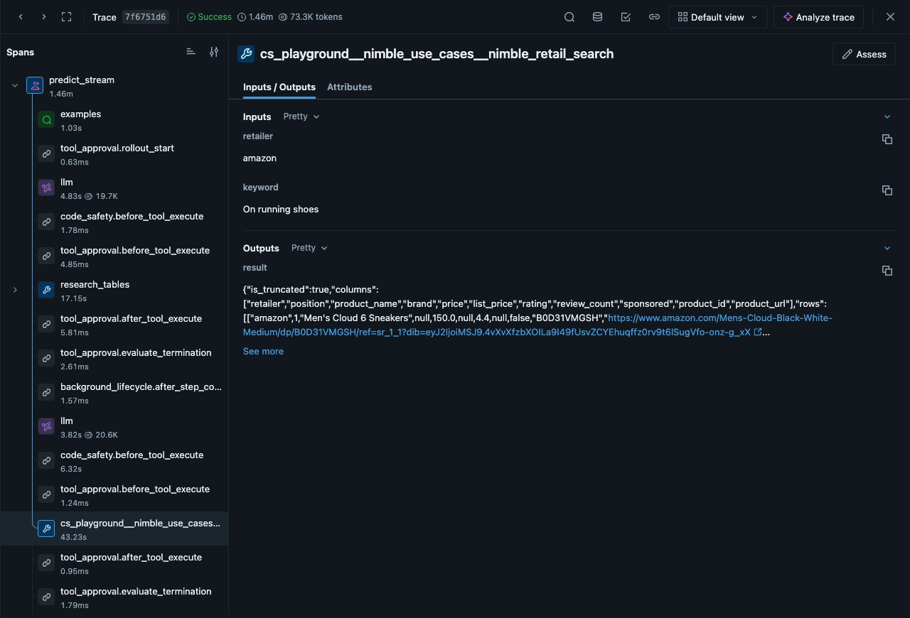

# Nimble on Databricks

This repository installs three working examples of live web data in your Databricks workspace. Nimble is the web data platform that collects the data. Every example runs on serverless compute and writes to Delta tables in Unity Catalog.



## Quick start

1. In your workspace, open **Workspace > Create > Git folder** and paste `https://github.com/amaurynimble/nimble-databricks-use-cases`.
2. Open `00_install` and attach serverless compute. Fill in a catalog, a schema name and your Nimble API key, then click **Run all**. The install takes about two minutes.
3. Open a use case folder and click **Run all** on each notebook, in number order.

Your Nimble account team gives you the API key. If your team already has a Nimble account, an admin can create a key at https://online.nimbleway.com/account-settings/api-keys.

## What lands in your workspace

| Folder | Use case | What you get |
|---|---|---|
| [`1_data_feed`](1_data_feed/) | A daily retail pricing feed that you can test against the feed you buy today | The table `shelf_products`, a daily job, a SQL alert and an AI/BI dashboard |
| [`2_agentic_research`](2_agentic_research/) | Research tasks written in plain language and run by a Nimble agent | The tables `competitor_earnings` and `product_reviews`, with a source URL on every value, and a Genie space |
| [`3_platform_integration`](3_platform_integration/) | One governed Nimble connection for every notebook, query and agent | A Unity Catalog MCP connection, an Agent Bricks agent and audit queries |

Each folder has its own README with the notebooks, the run times and a screenshot.

The examples cover running shoes from Nike and its competitors on five US retailers. To track other products, change the keyword list, the company list or the watchlist.



## Before you install

- Your workspace needs Unity Catalog, serverless notebooks and a serverless SQL warehouse.
- You need a catalog where you can create a schema.
- Genie and Agent Bricks need the workspace preview **Enable networking for isolated workloads in Serverless SQL Warehouses**. Turn it on under Settings > Previews, then stop and start the warehouse. The notebooks work without it.
- Outbound calls go over HTTPS to `sdk.nimbleway.com` and `mcp.nimbleway.com`.

The install stores your key in the Databricks secret scope `nimble`. It saves your settings to `.nimble_use_cases.json` in your home folder, so the other notebooks run without questions.

## What the install creates

The schema holds the tables from each use case and these Python table functions:

| Function | What it returns |
|---|---|
| `nimble_search(query, max_results, focus)` | Live web search results with page content |
| `nimble_retail_search(retailer, keyword)` | The products a shopper sees right now on one retailer |
| `nimble_product_reviews(asin)` | The live Amazon product page for one product, with the review summary |
| `nimble_wsa_start(agent_id, input, ...)` and `nimble_wsa_result_json(agent_id, run_id)` | The start of a Web Search Agent run, and then its rows |

```sql
SELECT title, url, content
FROM nimble_search('Nike Pegasus 42 review', 4);
```

## Repository layout

| Path | What it holds |
|---|---|
| `00_install.py` | The install notebook |
| `common/` | The Python client for the Nimble API, the shared helpers and `sql/functions.sql` |
| `1_data_feed/`, `2_agentic_research/`, `3_platform_integration/` | One folder per use case, with notebooks in Databricks source format |
| `docs/images/` | The screenshots in these READMEs |

## Remove everything

To remove everything, you drop the schema and delete the job, the alert, the dashboard, the Genie space and the Agent Bricks agent.

## License

The code is released under the Apache License 2.0. See [LICENSE](LICENSE).
